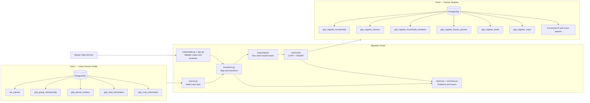
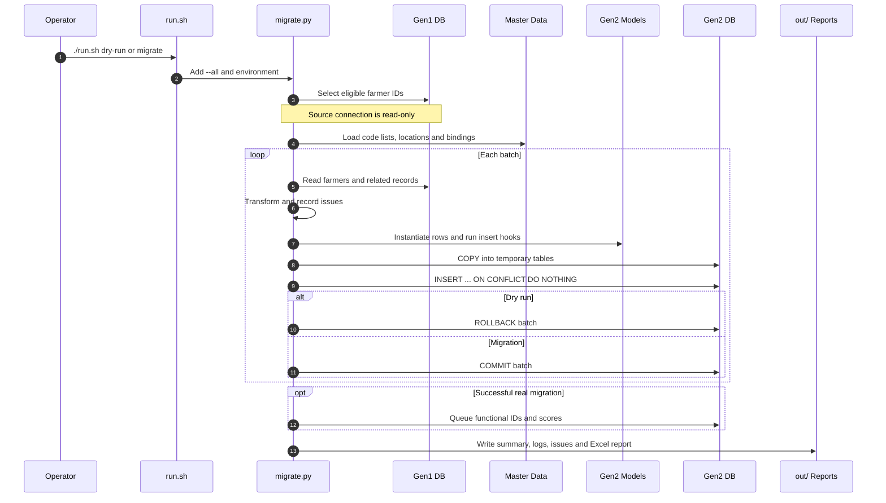
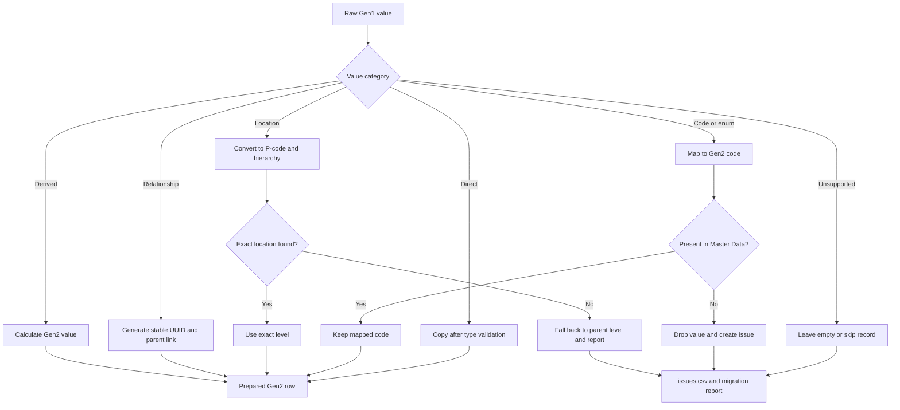
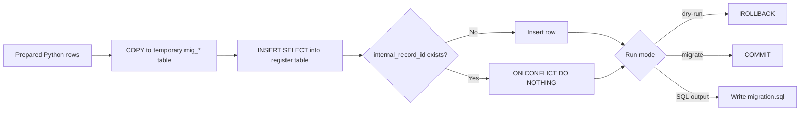
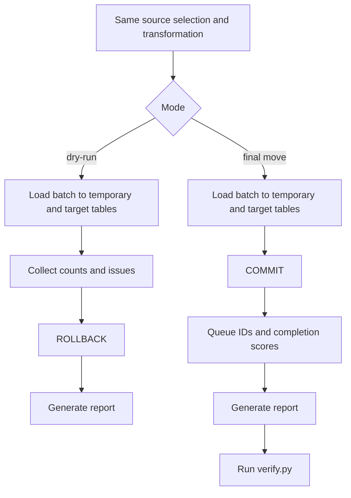
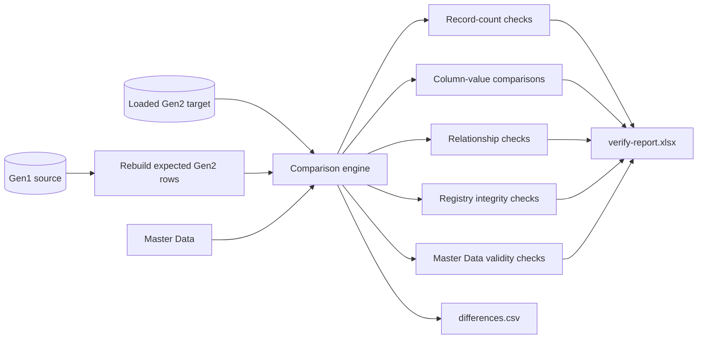
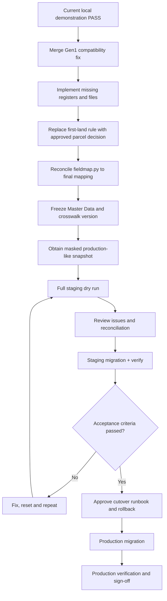

# Farmer Registry Gen1 → Gen2 Migration Script

## Presentation guide and local demonstration

**Date:** 13 November 2026
**Repository:** `anteneh1621/farmer-registry-migration`
**Tested upstream commit:** `8d6e819`
**Purpose:** Explain the migration approach, demonstrate a safe local run, verify the result, and identify the work remaining before production.

---

## 1. Executive message

The migration script is a controlled ETL pipeline:

1. It reads eligible farmers from the Gen1 Odoo PostgreSQL database using a read-only connection.
2. It reads related household members, phone numbers, lands, and crops.
3. It converts Gen1 values into Gen2 register values.
4. It validates codes and locations against Master Data.
5. It executes Gen2 registry model hooks in memory.
6. It loads the prepared records into Gen2 in dependency order and in database transactions.
7. It produces issue, summary, and Excel reports.
8. A separate verification program compares Gen1-derived expected values with the loaded Gen2 values.

The local demonstration passed verification, but the current script does not yet cover the complete approved field-mapping scope. It must not be described as production-ready until the gaps in Section 13 are closed.

---

## 2. The architecture at a glance



### What to say

> “The script does not copy tables blindly. It reads related Gen1 business records, transforms them into Gen2 register objects, validates governed values, runs the Gen2 model hooks, and then loads finished rows transactionally.”

---

## 3. Main files and responsibilities

| File | Responsibility |
|---|---|
| `run.sh` | Friendly command wrapper: setup, dry-run, migrate, verify, fresh, summary, SQL and tests. |
| `migrate.py` | Orchestrates selection, batching, transformation, loading, finalization and reporting. |
| `verify.py` | Recomputes expected Gen2 values from Gen1 and compares them with the loaded target. |
| `farmer_profile/source.py` | Selects farmers and reads households, members, IDs, phones, lands and crops. |
| `farmer_profile/transform.py` | Builds Gen2 rows and records skipped, dropped and check issues. |
| `farmer_profile/codes.py` | Maps Gen1 values to Gen2 governed codes. |
| `farmer_profile/geo.py` | Converts old location codes to P-codes and builds hierarchy. |
| `farmer_profile/masterdata.py` | Loads valid Master Data values and target-field bindings. |
| `farmer_profile/load.py` | Runs Gen2 hooks, stages with PostgreSQL `COPY`, and inserts idempotently. |
| `farmer_profile/finalize.py` | Queues functional IDs and farmer completion scores. |
| `farmer_profile/fieldmap.py` | Classifies the treatment of source fields and target columns for reporting. |
| `farmer_profile/inventory.py` | Counts populated fields and columns for reconciliation. |
| `farmer_profile/report.py` | Produces the migration and verification Excel workbooks. |

---

## 4. End-to-end migration sequence



---

## 5. Farmer selection and source reading

The script selects records using this business scope:

```text
is_registrant = true
is_group = false
active = true
```

The source connection is explicitly set to read-only in the worker process.

For every selected farmer, the script reads:

- all members of the same household;
- registration identifiers;
- income sources;
- phone numbers;
- land records;
- crop records;
- enumerator and location information.

The farmers are ordered by household so a batch does not intentionally split a household.

### Important local finding

The installed local Gen1 database contained only standard Odoo demonstration contacts:

- 40 `res_partner` rows;
- 0 farmer registrants;
- 0 memberships;
- 0 lands;
- 0 crops;
- 0 livestock records.

Therefore, a separate database named `farmer_registry_migration_demo_20261113` was created for the demonstration. It contains clearly labeled synthetic records and does not modify the installed Gen1 database.

---

## 6. Transformation approach



### Stable record IDs

Gen2 internal IDs are deterministic UUID5 values based on:

```text
farmer-profile/<entity>/<odoo-id>
```

This provides repeatability: rerunning the same source record generates the same target ID.

---

## 7. Why Master Data is central

The target registry does not accept arbitrary business codes. The migration loads:

- governed value lists;
- location P-codes;
- location hierarchy;
- metadata describing which code list applies to which target field.

If a value is absent from Master Data:

- a scalar coded field is left empty;
- invalid members of a list are removed;
- an issue is written;
- verification checks the loaded values again.

### Presentation message

> “Master Data is not an optional lookup. It is part of the migration acceptance boundary. The approved crosswalk and Master Data release must be frozen before production migration.”

---

## 8. Database loading and transaction safety

The loader uses a two-stage pattern:



Key controls:

- one database transaction per batch;
- a failed batch is rolled back;
- dry-run always rolls back;
- reruns do not duplicate existing `internal_record_id` values;
- the SQL-output mode produces one reviewable transaction;
- source database sessions are read-only.

---

## 9. Difference between commands

| Command | Target effect | Main purpose |
|---|---|---|
| `./run.sh setup` | Creates local test services | Prepare isolated environment. |
| `./run.sh test` | No business records loaded | Run automated unit tests. |
| `./run.sh dry-run` | Writes each batch, then rolls it back | Test the complete transformation and load path safely. |
| `./run.sh migrate` | Commits records | Perform a real load into the configured target. |
| `./run.sh verify` | Read-only | Compare expected Gen2 values with the loaded database. |
| `./run.sh fresh` | Resets only the local disposable target, migrates, verifies | Full local final-move rehearsal. |
| `./run.sh sql` | Writes `migration.sql`; does not load | Allow SQL review and controlled application. |
| `./run.sh apply` | Applies the latest generated SQL | Execute the reviewed SQL transaction. |
| `./run.sh summary` | Read-only | Show latest migration and verification summaries. |

---

## 10. Dry-run versus final move



Dry-run and migration use the same transformation and SQL-loading logic. The principal difference is rollback versus commit and finalization.

---

## 11. Verification approach

Verification does not simply count target rows. It independently rebuilds the expected target records from Gen1 using the same approved transformation components, then compares them with the target.



The verifier exits with a failure code if any check fails.

---

## 12. Results from the local demonstration

### Environment

| Component | Local test resource |
|---|---|
| Synthetic Gen1 source | `farmer_registry_migration_demo_20261113` |
| Disposable Gen2 target | `fr-migration-target` |
| Local Master Data | `fr-migration-mds` |
| Docker network | `fr-migration` |
| Registry image | `openg2p/openg2p-registry-staff-api:1.2.2-rc.625` |
| Country pack commit | `db3e2ff6e9cc764648c1348708c37cfec8e941c3` |

### Unit tests

- **16 passed**
- **0 failed**

### Dry run

| Result | Count |
|---|---:|
| Selected farmers | 2 |
| People read, including household members | 3 |
| Batches | 1 |
| Failed batches | 0 |
| Households prepared | 2 |
| Farmers prepared | 3 |
| Household members prepared | 3 |
| Phones prepared | 2 |
| Lands prepared | 2 |
| Crops prepared | 2 |

All target writes were rolled back.

### Local final-move test

| Loaded or queued item | Count |
|---|---:|
| Households loaded | 2 |
| Farmers loaded | 3 |
| Household members loaded | 3 |
| Farmer phones loaded | 2 |
| Lands loaded | 2 |
| Crops loaded | 2 |
| Functional-ID requests queued | 3 |
| Completion-score requests queued | 105 |

### Verification

| Verification result | Count |
|---|---:|
| Checks passed | 76 |
| Checks failed | 0 |
| Warnings | 2 |
| Values compared | 375 |
| Columns compared | 148 |
| Value differences | 0 |

**Verdict: PASS**

The two warnings are expected in the synthetic fixture because it intentionally contains no geographic P-codes.

---

## 13. Issues and production blockers

### Issues demonstrated by the fixture

The migration correctly reported five issues:

1. Two crops had no parcel reference and were assigned to the farmer's first land.
2. One farmer with no household was given a generated household.
3. One crop was skipped because its farmer had no land.
4. One land ownership value had no valid target Master Data code and was dropped.

These show that reporting works; they do not mean the rules are approved for production.

### Blocking gaps against the final mapping

The current migration does not yet migrate:

- Livestock;
- Farm Inputs;
- Membership Details;
- documents;
- farmer photographs;
- land-certificate files;
- Gen1 record history.

Additional blockers:

- Crop-to-land currently uses “first land”; the approved mapping requires evidence-based assignment and quarantine when ambiguous.
- Five source fields are still classified as `Not reviewed` in `fieldmap.py`; this must become zero.
- The report identifies 38 Gen1 fields and 80 Gen2 columns as `Not migrated yet`; these require reconciliation against the final mapping.
- A masked, production-like Gen1 snapshot is required for realistic volume, performance, null, duplicate and value-distribution testing.
- Consent and document interfaces must be confirmed and tested separately.

### Compatibility defect found and fixed locally

The script queried `res_partner.is_duplicated`, but the installed Gen1 schema does not contain that column. The local compatibility patch uses:

```sql
NULL::boolean AS is_duplicated
```

After this change:

- all 16 unit tests passed;
- the full dry run completed;
- the local final move completed;
- verification passed with zero value differences.

This change should be reviewed and committed upstream before a shared rehearsal.

---

## 14. Recommended production-readiness path



---

## 15. Live presentation script

### Opening — 30 seconds

> “Today I will demonstrate the Gen1-to-Gen2 migration approach using an isolated local source, a disposable Gen2 database, and a local Master Data service. No production system is connected. I will show the dry run, the committed local move, independent verification, and the gaps that remain before production.”

### Show the architecture — 60 seconds

Emphasize:

- Gen1 is read-only;
- transformation is explicit;
- Master Data controls codes and locations;
- Gen2 model hooks run before loading;
- batches are transactional;
- every run creates evidence.

### Run automated tests — 20 seconds

```bash
./run.sh test
```

Expected message:

```text
16 passed
```

### Run the dry run — 60 seconds

```bash
./run.sh dry-run
```

Point out:

- source and target names are local;
- `DRY RUN` appears in the summary;
- zero failed batches;
- every batch is rolled back;
- the `out/` folder contains the report and issues.

### Show the final-move rehearsal — 60 seconds

```bash
./run.sh fresh
```

Explain that `fresh`:

1. resets only `fr-migration-target`;
2. migrates the synthetic source;
3. runs verification automatically.

### Show the summary — 60 seconds

```bash
./run.sh summary
```

Highlight:

- 76 passed, 0 failed;
- 375 values compared;
- zero differences;
- two expected location warnings;
- reported data issues are visible and actionable.

### Close — 30 seconds

> “The core pipeline, transactional safety, evidence generation, and verification are working in the local rehearsal. The result is a successful technical proof, not yet production approval. The remaining work is to implement the missing domains, align the crop-to-land rule with the approved mapping, eliminate unreviewed fields, and rehearse against a masked production-like snapshot.”

---

## 16. Questions senior officials may ask

### Does the script change Gen1?

No. The migration opens the source connection in read-only mode. The local fixture is in a separate cloned database.

### Can a dry run leave partial data?

No. Each target batch is rolled back. The dry-run report describes what would have been added.

### What happens if a batch fails during migration?

The batch transaction is rolled back. By default the run stops. A rerun uses deterministic IDs and `ON CONFLICT DO NOTHING` to avoid duplicates.

### How are invalid codes handled?

Values absent from Master Data are not guessed. They are left empty or removed from lists and reported as issues.

### How do we prove the migration is correct?

`verify.py` reconstructs expected Gen2 rows from Gen1, compares values and relationships, checks target integrity and Master Data validity, and writes an Excel report plus detailed differences.

### Is the script complete for production?

No. The local proof passed for the currently implemented scope, but Livestock, Farm Inputs, Membership Details and files are still missing, and the crop-to-land rule conflicts with the approved mapping.

### What is the production go/no-go condition?

All in-scope domains implemented, zero unreviewed source fields, frozen Master Data, approved exception rules, successful full staging migration, zero failed verification checks, accepted reconciliation, and a tested rollback runbook.

---

## 17. Evidence to open during the meeting

| Evidence | File |
|---|---|
| Final mapping | `Gen1-to-Gen2-Data-Migration-Mapping_FINAL.xlsx` |
| Final project plan | `Farmer-Registry-Migration-Project-Plan_FINAL.xlsx` |
| Dry-run workbook | `dry-run/migration-report.xlsx` |
| Dry-run issues | `dry-run/issues.csv` |
| Final-move workbook | `final-move/migration-report.xlsx` |
| Verification workbook | `verification/verify-report.xlsx` |
| Verification differences | `verification/differences.csv` |
| Command-oriented runbook | `docs/presentation-runbook.md` |

All paths above are relative to `presentation-evidence/`.

---

## Final conclusion

The demonstration proves that the implemented migration path can:

- read Gen1 safely;
- transform and validate records;
- load Gen2 transactionally;
- report exceptions;
- queue post-load work;
- independently verify loaded values.

The demonstrated result is technically successful: **76 verification checks passed, zero failed, and zero value differences were found.**

Production approval remains conditional on completing the missing migration domains and resolving the approved mapping decisions.

